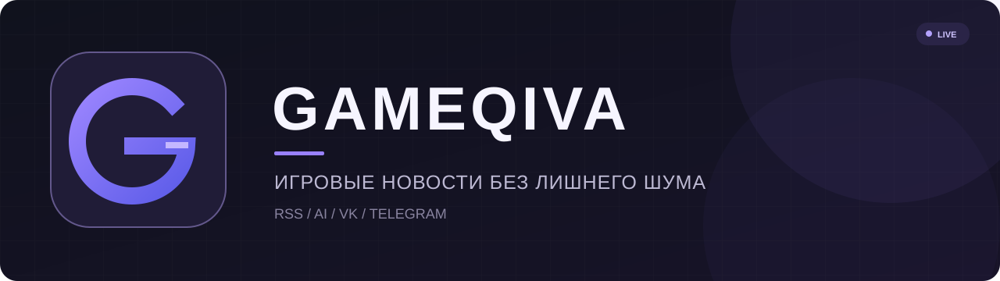

<div align="center">



# GAMEQIVA

**Новости игр, технологий и индустрии — в одном месте.**

Автоматический сбор, проверка и публикация новостей игровой индустрии в VK и Telegram.

[](https://github.com/Zeihos/Gameqiva/actions/workflows/autopost.yml)
[](https://github.com/Zeihos/Gameqiva/actions/workflows/ci.yml)


**[Новости во ВКонтакте](https://vk.com/gameqiva) · [Telegram-канал](https://t.me/gameqivo) · [Запуски бота](https://github.com/Zeihos/Gameqiva/actions/workflows/autopost.yml)**

</div>

---

> **GAMEQIVA** — проект автоматической публикации новостей. Бот отслеживает RSS, выбирает материалы официальных источников, составляет русскоязычный пост и отправляет его в социальные сети. Статус публикации для каждой площадки сохраняется отдельно.

### Навигация

[Возможности](#возможности) · [Как работает](#как-работает) · [Быстрый старт](#быстрый-старт) · [Настройка](#настройка-github-actions) · [Структура](#структура) · [Диагностика](#диагностика)

## Как работает

```text
51 RSS-источник
       │
       ▼
Отбор свежих материалов
       │
       ▼
Проверка официального источника и изображения
       │
       ▼
Подготовка русского текста (Gemini / Groq)
       │
       ▼
Редакторская проверка и защита от повторов
       │
       ├──────────────┐
       ▼              ▼
   VK-сообщество  Telegram-канал
       │              │
       └──────┬───────┘
              ▼
    data/state.json
```

## Возможности

- Проверка 51 RSS-источника (список: `sources.py`).
- Отбор свежих публикаций и защита от повторов.
- Генерация и редакторская проверка русского текста через Gemini / Groq.
- Публикация в VK и Telegram с независимым учётом результата каждой площадки.
- Повторная попытка отправить незавершённую публикацию без дублирования уже опубликованного сообщения.
- Предпросмотр без отправки сообщений (`DRY_RUN=1`).
- Автоматический запуск GitHub Actions каждый час (на 17-й минуте по UTC; фактический запуск зависит от очереди GitHub).

## Быстрый старт

1. Создайте секреты для AI, VK и Telegram (таблица ниже).
2. Откройте [GAMEQIVA Auto Publish](https://github.com/Zeihos/Gameqiva/actions/workflows/autopost.yml).
3. Запустите **Run workflow** с `publish = false`, чтобы проверить генерацию без публикации.
4. После проверки запустите `publish = true`. Для обычной работы используется почасовое расписание.

## Настройка GitHub Actions

Откройте **Settings → Secrets and variables → Actions** и добавьте секреты:

| Секрет | Назначение |
| --- | --- |
| `GROQ_API_KEY` | Ключ Groq (достаточно одного AI-провайдера) |
| `GEMINI_API_KEY` | Необязательный ключ Gemini |
| `VK_USER_TOKEN` | **Токен сообщества VK**, используется для публикации постов |
| `VK_PHOTO_USER_TOKEN` | **Необязательный пользовательский токен VK** с разрешениями для загрузки фотографий |
| `TG_BOT_TOKEN` | Токен Telegram-бота |

Telegram-канал `@gameqivo` и короткое имя сообщества VK `gameqiva` уже заданы в workflow. Бот Telegram должен иметь право публиковать в канале. Для VK при необходимости можно задать числовой ID сообщества в переменной репозитория `VK_GROUP_ID`.

**Важно о фотографиях VK:** токен сообщества не поддерживает `photos.getWallUploadServer`. Если `VK_PHOTO_USER_TOKEN` не задан или не имеет нужных прав, бот размещает **текст со ссылкой на оригинал** вместо фотографии. Это штатный резервный режим, а не ошибка публикации. Не размещайте ключи в коде, issue или публичных логах.

## Запуск

Перейдите в **Actions → GAMEQIVA Auto Publish → Run workflow**.

- `publish = false` — проверить сбор новостей и генерацию, ничего не публиковать.
- `publish = true` — опубликовать одну новость или завершить незавершённую публикацию.

Плановая проверка запускается каждый час на 17-й минуте (в том числе в Красноярске). Бот публикует **не более одной новой новости за час**, только если нашёл проверенный материал с подходящим изображением. Если достойной новости нет, публикация пропускается: бот не генерирует вымышленные события. GitHub Actions может запускаться с задержкой. Уже начатые публикации на одной площадке бот пытается завершить на другой без повторной отправки на успешную площадку.

## Разработка и тесты

Для проверки изменений без отправки новостей настроен отдельный workflow **[Проверка кода](https://github.com/Zeihos/Gameqiva/actions/workflows/ci.yml)**. Он запускается при изменениях Python-файлов и зависимостей в push/PR. Основной workflow отвечает за публикацию. Пример локальной конфигурации — [`.env.example`](.env.example); реальные значения храните только в `.env` или GitHub Secrets.


Требуется Python 3.12+.

```bash
python -m pip install -r requirements.txt
python -m unittest -q test_editorial test_editorial_safety test_rss_collector test_feed_health test_vk_publishing
```

Для предпросмотра задайте в окружении `GROQ_API_KEY` или `GEMINI_API_KEY`, установите `DRY_RUN=1` и выполните `python run.py`.

## Структура

| Файл | Назначение |
| --- | --- |
| `run.py` | Генерация, публикация и сохранение результатов |
| `sources.py` | Список источников |
| `rss_collector.py` | Сбор RSS |
| `editorial.py` | Редакторские проверки |
| `feed_health.py` | Диагностика источников |
| `data/state.json` | Состояние опубликованных и незавершённых постов |
| `test_*.py` | Автоматические тесты |
| `.github/workflows/autopost.yml` | Расписание и публикация |
| `.github/workflows/ci.yml` | Независимая проверка кода |

## Диагностика

- **VK error 27 на `photos.getWallUploadServer`** — токен сообщества не подходит для загрузки фото; нужен отдельный пользовательский токен либо используется текстовый резервный режим.
- **VK error 5 / invalid access_token** — токен недействителен.
- **VK error 15** — недостаточно прав для операции.
- **Gemini HTTP 404** — модель недоступна через используемый API; при наличии Groq бот пытается перейти на него.
- **Пост есть в Telegram, но отсутствует в VK** — проверьте `data/state.json`: значения `tg_id` и `vk_id` фиксируются независимо.

---

<div align="center">

**GAMEQIVA · Новости игр и технологий**

[VK](https://vk.com/gameqiva) · [Telegram](https://t.me/gameqivo) · [Исходный код](https://github.com/Zeihos/Gameqiva)

</div>

> Безопасность: не коммитьте `.env`, токены, приватные данные и логи с секретами. Публичный доступ к исходному коду сам по себе не означает наличие лицензии на его повторное использование.
